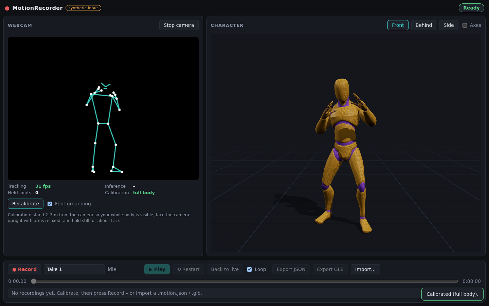

# MotionRecorder

Record your own body movement with a webcam, retarget it live onto the Quaternius
mannequin, and export it as a portable, reproducible animation (versioned JSON or
a standalone GLB) that replays identically on a fresh instance of the same rig.

Everything runs in the browser. Webcam frames never leave the device: pose
inference runs locally with MediaPipe (WASM/WebGL); only the model file may be
fetched from Google's CDN if it is not present locally.



## Quick start

```bash
npm install            # also copies the MediaPipe WASM runtime into public/mediapipe/wasm
npm run fetch-model    # optional: store pose_landmarker_full.task locally (otherwise loaded from CDN)
npm run dev            # http://localhost:5173
```

Requirements: Node 20+, a Chromium-based browser or Firefox/Safari with WebGL2.
Camera access needs a secure context (`localhost` or HTTPS).

No webcam? Open `http://localhost:5173/?source=synthetic` – a deterministic
synthetic pose stream (generated from the mannequin's own clips) replaces the
camera so the full pipeline can be tried and tested.

## Using it

1. **Start camera** – grant permission, pick a camera if you have several. The
   mirrored preview shows the detected skeleton. Stand 2–3 m away so your whole
   body is visible.
2. **Calibrate** – stand upright, face the camera, arms relaxed, hold still for
   ~1.5 s. Calibration captures your neutral torso/head orientation so it maps
   onto the mannequin's rest pose. If your legs are not visible it calibrates
   upper body only and the legs stay at rest. Recalibrate anytime.
3. **Ready** – the mannequin follows you live.
4. **Record / Stop** – name the take first (or rename it later). Takes are stored
   in IndexedDB and survive reloads.
5. **Playback** – Play/Pause, Restart, Loop and timeline scrubbing. While a take is
   playing, live tracking does not drive the bones. *Back to live* returns to
   tracking.
6. **Export JSON / Export GLB / Import…** – import accepts both formats.

Modes shown top-right: Camera Disabled → Tracking → Calibrating → Ready →
Recording / Playback.

## Architecture

```
webcam ─► MediaPipe PoseLandmarker (VIDEO mode, GPU→CPU fallback, adaptive frame stride)
          │  33 image + world landmarks with visibility
          ▼
     LandmarkFilter (One-Euro per joint, confidence gating)
          ▼
     Calibrator ──► CalibrationData (neutral pelvis/chest/head offsets, legs tracked?)
          ▼
     Retargeter (rig-specific, quaternion only)
          │  local bone rotations + vertical hips offset
          ▼
     QuaternionSmoother ─► MotionEngine.update() ─► mannequin bones (Three.js)
                                    │                    ▲
                                    ├─► MotionRecorder ──┘ (samples final local pose)
                                    └─► MotionPlayer (AnimationClip, deterministic sampling)
```

| Path | Responsibility |
| --- | --- |
| `src/rig/rigSpec.ts` | Bone mapping for this exact rig (`DEF-*` Rigify names), driven bones, target height |
| `src/rig/rigDefinition.ts` | Rest hierarchy, forward kinematics, rig signature |
| `src/rig/retargeting.ts` | Landmarks → local quaternions: torso frames from hips/shoulders, swing-twist limb aiming in the parent's frame, hinge planes to fix forearm/shin twist, occlusion hold and release-to-rest, foot grounding |
| `src/rig/poseFiltering.ts` | One-Euro landmark filter, quaternion smoothing |
| `src/tracking/` | Camera access, MediaPipe wrapper, calibration, synthetic source |
| `src/recording/` | Motion format + validation, recorder (resamples to a fixed fps), playback |
| `src/export/`, `src/import/` | JSON and GLB export/import |
| `src/engine/MotionEngine.ts` | Single owner of the bones each frame; mode state machine |
| `src/components/`, `src/viewport/` | React UI, React Three Fiber viewport |

### Retargeting approach

- Only **rotations** are transferred; positions of the user are never copied to
  bones, so bone lengths and the mannequin's proportions are preserved.
- MediaPipe world landmarks are converted to the mannequin's frame (+Y up, +Z
  forward). The pelvis orientation comes from the hip line and the hip→shoulder
  axis, the chest from the shoulder line, the head from ears/eyes/nose.
- Each limb segment is aimed by the shortest-arc rotation from its rest direction
  to the observed direction, expressed in the parent's (already solved) frame.
  The elbow/knee bend plane determines the twist so upper arms and thighs do not
  spin.
- Joints whose landmarks have low visibility hold their last pose for a while
  and then ease back to rest.
- Root motion: no horizontal translation is invented. With *Foot grounding* on,
  the hips are lowered by the amount the legs bend so the feet stay on the
  floor (crouches look right); otherwise the hips stay in place.

## Motion file format (JSON, version 1)

```jsonc
{
  "format": "motion-recorder",
  "version": 1,
  "name": "My First Animation",
  "createdAt": "2026-11-11T10:00:00.000Z",
  "duration": 2.6,                // seconds
  "fps": 30,                      // every track is sampled on the same uniform time base
  "frameCount": 79,
  "space": "local",               // relative to the parent bone, like glTF animation channels
  "quaternionOrder": "xyzw",
  "interpolation": "linear",      // slerp for rotations
  "rig": {
    "id": "quaternius-ual-mannequin",
    "signature": "…",             // hash of bone names + parent links
    "boneCount": 53,
    "upAxis": "+Y", "forwardAxis": "+Z", "units": "rig", "rawHeight": 1.83,
    "bones": [ { "name": "DEF-hips", "parent": "root", "translation": [...], "rotation": [...], "scale": [...] }, … ]
  },
  "tracks": [
    { "bone": "DEF-upper_arm.L", "property": "rotation",    "times": [0, 0.0333, …], "values": [[x, y, z, w], …] },
    { "bone": "DEF-hips",        "property": "translation", "times": [0, 0.0333, …], "values": [[x, y, z], …] }
  ],
  "meta": { "source": "webcam", "rootMotion": "vertical-grounded" }
}
```

Bone names are the original glTF node names. The rest pose of every bone is
embedded so a consumer can rebuild untracked bones without the GLB. Quaternions
are kept in a continuous hemisphere between keys. A sample file is in
[`examples/`](examples/).

**Import validation** (`src/recording/motionFormat.ts`): format and version,
rig id and skeleton signature (rejected if they do not match the loaded rig),
track structure, strictly increasing finite times within the duration, value
arity, finite numbers, unit-length quaternions (renormalised within tolerance,
rejected otherwise), size limits. Tracks for unknown bones are dropped with a
warning. Files are parsed with `JSON.parse` only; nothing is executed.

## GLB export

`Export GLB` writes the mannequin (mesh, skin, skeleton) plus exactly one
animation – the recording – using the original node hierarchy, so it opens in
Blender, three.js, Babylon or any glTF viewer. The 46 library clips are removed.
Every joint gets a channel (untracked joints hold their rest pose), rotations as
local `rotation` channels, hips as `translation`, linear interpolation, original
timing.

Before the file is offered for download, the app re-imports it in memory onto a
fresh mannequin and compares it to the recording; a failed check aborts the
export. Unit tests additionally run the Khronos glTF validator (0 errors) and
replay the re-imported clip on a fresh rig instance.

## Tests

```bash
npm run check      # lint + typecheck + unit tests + production build
npm run test:e2e   # Playwright (first time: npx playwright install chromium)
```

- **Unit (Vitest, `tests/unit/`)** – retargeting accuracy against synthetic
  landmarks generated from the rig's own clips (limb directions, pelvis axis,
  head, arm twist), occlusion handling, grounding, recorder time base and
  quaternion continuity, playback interpolation, `AnimationClip` targets, JSON
  round trip and every rejection path, GLB validation, re-import and replay on a
  fresh rig.
- **E2E (Playwright, `tests/e2e/`)** – runs the app with `?source=synthetic`:
  start → calibrate → live tracking moves the bones → record → deterministic
  scrubbing → JSON and GLB download → delete → re-import both → replay matches
  the original → reload keeps the takes; invalid / wrong-rig files are rejected.

`npm run generate:synthetic` regenerates `src/tracking/synthetic/sequence.json`.

### What still needs a human

Automated tests cannot judge tracking quality with real people. Please verify
with a real webcam: different body sizes, distance, lighting, partial
occlusion (sitting at a desk → upper body only), fast motions, and that a
recorded take looks the same after export → import in a fresh browser profile
and in Blender.

## Known limitations

- Monocular pose estimation: depth (arms pointing at the camera) and wrist/hand
  rotation are approximate. Fingers are not tracked; hands are only aimed
  from the wrist towards the index/pinky landmarks.
- No horizontal root motion (in-place recording); vertical hips motion only via
  foot grounding.
- The retargeting is specific to this mannequin rig; other rigs are rejected on
  import by design.
- Tracking runs at the camera rate on good hardware; on slow GPUs/CPU fallback
  inference is throttled adaptively (shown as "1/n frames").
- The pose model is downloaded from Google's CDN unless `npm run fetch-model` was
  run.

## License

Code: MIT. Mannequin: Quaternius Universal Animation Library, CC0. See
[`LICENSE`](LICENSE).
